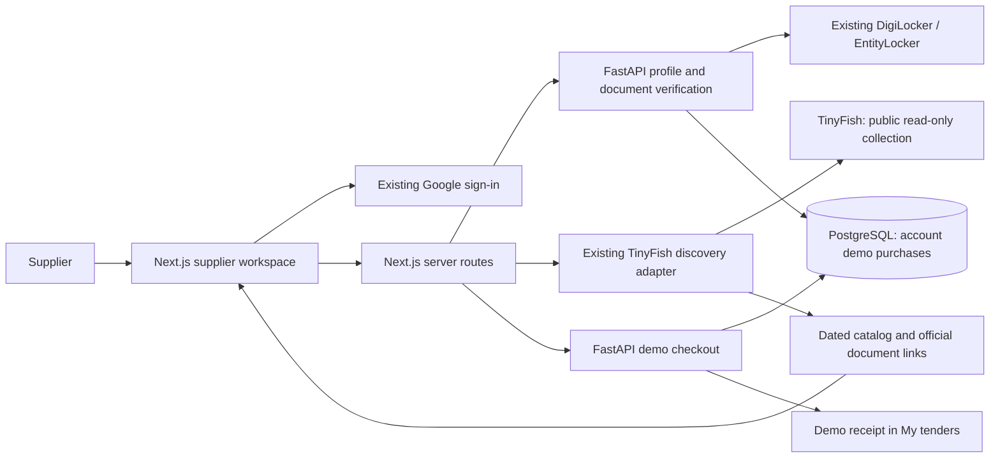

# TenderLens architecture: simplified supplier workflow

Updated 25 October 2026. The current product direction is defined in the [PRD](PRD.md) and [final workflow plan](IMPLEMENTATION_PLAN.md).

## Working components

## Existing integrations retained

- Firebase handles Google sign-in; FastAPI verifies ID tokens and resolves the supplier's workspace.
- Profile requests go through `/api/profile` to the existing versioned backend profile.
- Document verification goes through `/api/certificates` to the existing server-owned DigiLocker/EntityLocker flow. Its consent, check, restart, issuer and holder checks remain intact.
- `/api/tenders` retains the shared current catalog. Local discovery uses Next.js run files; remote workspace mode uses FastAPI's existing catalog/worker. Both retain the dated recorded real snapshot as the existing fallback.
- `/api/discovery` retains the existing metered, explicitly initiated TinyFish workflow.

## Review and demo purchase

1. The browser displays source facts and links. It does not use readiness scoring as a purchase prerequisite.
2. The browser sends the selected tender ID, a source-content review version and both acknowledgements to `POST /api/purchases`.
3. Next.js resolves the current catalog itself, checks the review version and deadline, and forwards only the selected source snapshot and acknowledgements to FastAPI.
4. FastAPI checks the saved supplier profile, validates the snapshot's stable identity and approved source hosts, and creates or returns the workspace's one demo order for that tender.
5. `POST /api/purchases/{id}/pay` rechecks the current notice before forwarding the chosen simulated outcome. FastAPI rechecks ownership and the deadline under a database row lock.
6. Success stores the timestamp and returns a stable `DEMO-` receipt. Failure is retryable. An already purchased order always returns its existing receipt.
7. My tenders reads the account's orders from the backend and can recover receipts independently of the current source catalog.

The backend demo API accepts a validated selected-notice snapshot. This is a record of a simulation, not issuer-authorized payment evidence. A real checkout must resolve an issuer-authoritative catalog, price and payment confirmation before adding any paid status.

## New API contracts

All routes require the existing Firebase bearer token. Next.js mutation routes also reject cross-origin requests.

| Browser route | Backend route | Purpose |
| --- | --- | --- |
| `GET /api/purchases` | `GET /api/v1/demo-purchases` | Account order history |
| `POST /api/purchases` | `POST /api/v1/demo-purchases` | Start/resume one demo order after review |
| Internal server lookup | `GET /api/v1/demo-purchases/{id}` | Ownership-checked order lookup |
| `POST /api/purchases/{id}/pay` | `POST /api/v1/demo-purchases/{id}/pay` | Simulated success/failure |

New migration: `b23d9e6f8a01_demo_purchases`, following the existing certificate-verification migration.

## Persistence and correctness

The `tenderlens_api.demo_purchases` table stores the workspace, user, stable tender key, notice snapshot, supplier snapshot, simulated amount, state, identity label and timestamps.

A unique workspace/tender constraint prevents duplicate starts. Row locking serializes outcomes. Successful purchase state and receipt timestamps cannot be reversed by a delayed failure. The server owns the amount and receipt; the browser cannot claim a verified identity, paid amount or status through the purchase request.

DigiLocker status is derived from a current PAN receipt bound to the saved contact, provider and environment. Test receipts stay test receipts. Demo checkout may proceed unverified and records that fact. Supplier profile facts alone cannot award verification.

## Scope and deployment

No payment provider, banking form, new AWS service or new credentials are introduced. The existing application regions and deployment configuration remain unchanged. Starting this checkout requires the existing backend/database and the new migration.

The earlier PDF extraction, condition evaluation and amendment-diff backend modules remain in the repository for future iterations. They are outside the primary supplier review/purchase flow. No new deployment is claimed by this refactor.
