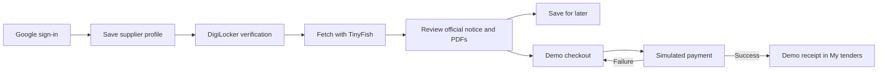

# Final supplier workflow implementation plan

Updated 25 October 2026 after round 2 mentoring. This replaces the earlier 24-hour plan.

## Simplified problem statement

Small suppliers need one place to find an official tender, understand what to review, and complete a clear purchase journey.

TenderLens lets a supplier sign in with Google, save a business profile, connect DigiLocker, fetch notices with TinyFish, review the official documents, and complete a hackathon demo purchase with a saved receipt.

## Final workflow

1. **Sign in with Google.** Keep the existing Firebase sign-in and personal supplier workspace.
2. **Create the supplier profile.** Save business name, contact person, email and supply categories. Existing financial and certificate fields remain available but are not checkout prerequisites.
3. **Connect DigiLocker.** Keep the existing PAN identity verification and EntityLocker GST verification. Live verified, test passed and unverified are distinct. Verification is optional for the hackathon checkout; an unverified identity is never presented as verified.
4. **Fetch tenders with TinyFish.** Retain the existing source, progress, failure recovery, real snapshot and stable notice identities.
5. **Review one tender.** Show issuer, reference, original closing text, open/closed status, official PDFs, amendment links and collection time. The supplier reads specifications, eligibility, fee, EMD and submission instructions in the official documents.
6. **Choose a next step.** Save for later, or acknowledge the source review and demo terms and continue to checkout. Closed or unresolved deadlines cannot enter checkout.
7. **Complete demo checkout.** Show the saved supplier details, server-recorded DigiLocker status, ₹499 simulated amount and ₹0 actually charged. The supplier chooses a successful or failed simulated payment; no banking information is collected.
8. **Get the result.** Success saves a unique demo receipt. Failure stays on the same order and can be retried. Closing the panel preserves the unfinished order.
9. **Return to My tenders.** Resume by reviewing the current notice, download a receipt, or open the official documents. Purchases persist in the supplier account across reloads and devices.



DigiLocker is retained as a profile step; the demo can continue with an explicitly unverified identity.

## Scope decisions

| Keep | Simplify or defer |
| --- | --- |
| Google sign-in and account isolation | No new authentication system |
| Existing supplier profile and DigiLocker | Only basic saved details are required for demo checkout |
| TinyFish fetching and source provenance | No extra sources, new AI layer or discovery redesign |
| Official documents and amendment links | No automatic eligibility scoring or amendment comparison in the primary flow |
| Save for later | A bookmark does not reserve a tender |
| Demo checkout and saved receipts | No actual payment, bid submission, exclusive reservation or contract award |

The ₹499 figure is synthetic demo data. It is not an extracted tender fee, EMD, contract value, platform fee or amount charged. Public tender PDFs remain available without purchase.

## Implementation phases and deliverables

| Phase | Deliverable | Main files |
| --- | --- | --- |
| 1. Review | Replace readiness tabs with documents, supplier details and a next action | `frontend/components/tender-drawer.tsx` |
| 2. Discovery presentation | Open/closed/date-unconfirmed filters, review actions, saved shortlist and a four-step guide | `frontend/components/tender-explorer.tsx` |
| 3. Checkout service | Strict contracts, account-scoped persistence, immutable successful receipt and retryable failures | `backend/app/api/routes/purchases.py`, `backend/app/models/purchases.py` |
| 4. App integration | Resolve the tender from the current server catalog; bind the acknowledgement to that version | `frontend/lib/purchase-server.ts`, `frontend/app/api/purchases/` |
| 5. Checkout UI | Clearly labelled simulated payment outcomes and receipt download | `frontend/components/demo-checkout.tsx` |
| 6. My tenders | List account orders, resume unfinished checkout and recover receipts | `frontend/app/dashboard/purchases/page.tsx` |
| 7. Product alignment | Simplify navigation, landing copy, help, PRD and architecture | `docs/`, landing, shell and help |
| 8. Validation | Behavior tests, API tests, lint, types, formatting, build and HTTP/browser smoke checks | Frontend and backend test suites |

## Purchase state rules

```text
Review + acknowledgement → pending
pending → simulated failure → failed
pending or failed → simulated success → purchased + DEMO receipt
purchased → any repeated outcome → same purchased receipt
```

- One order per workspace and stable tender identity; database uniqueness handles simultaneous starts.
- Row locks serialize payment outcomes. A delayed failure cannot undo success.
- Supplier details come from the saved backend profile, not browser declarations.
- Identity status comes from server-owned PAN receipts matching the current contact, time and environment.
- The browser submits a notice identity and review version. The Next.js server supplies the current notice snapshot and does not forward a browser-provided price or status.
- If a notice changes before checkout or payment, ask for review again. Recollection alone does not invalidate review.
- The server rechecks the deadline during checkout and payment.
- Receipts preserve the purchased notice and supplier snapshot even if future catalog refreshes omit the notice.
- A storage or network failure never produces a local success receipt.

## Acceptance checklist

- [ ] Existing Google sign-in, profile save, DigiLocker consent/check/restart and TinyFish refresh still work with their configured services.
- [ ] A supplier can find an open notice, read the official PDFs and enter demo checkout.
- [ ] An incomplete backend profile cannot buy a tender.
- [ ] Closed and unknown deadlines are blocked; boundary equality counts as closed.
- [ ] A changed notice requires review again.
- [ ] Simulated failure followed by success produces one saved order and one receipt.
- [ ] Repeated or racing success/failure requests cannot duplicate or reverse a purchase.
- [ ] Another supplier cannot list, inspect or pay someone else's order.
- [ ] Test or missing DigiLocker verification never becomes a live verification badge.
- [ ] Reloading My tenders recovers saved orders; removed catalog notices retain receipt documents.
- [ ] The demo label and zero real charge are clear on review, checkout and receipt.
- [ ] Mobile layout, keyboard dialog use, lint, types, tests, build and smoke checks pass.

See [build status](BUILD_STATUS.md) for checks actually run. This checklist is the release gate, not a claim that external services were exercised.

## Run and present

1. Start the existing PostgreSQL instance and apply `cd backend && uv run alembic upgrade head`.
2. Start FastAPI on port 8000; configure the frontend's existing backend URL if needed.
3. Start the frontend on `localhost:3000`, the authorized Google sign-in host.
4. Sign in, save a profile and demonstrate DigiLocker if configured. Otherwise keep its unverified status visible.
5. Show the dated real TinyFish snapshot, or explicitly start a live run using the existing configuration.
6. Review an open tender, simulate a failed payment, retry successfully and download the demo receipt from My tenders.
7. Explain that a real purchase/payment integration is a future issuer-specific integration. The demo does not alter the issuer's procurement process.

No new payment account, payment secrets, AWS resources or paid TinyFish run is required to implement checkout.
