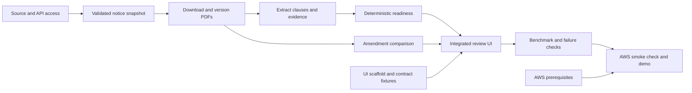

# TenderLens — Implementation Plan

**Status:** Implementation underway. The local landing page, dashboard, sample checks, and discovery adapter are built; [Build Status](BUILD_STATUS.md) records verified progress. This document retains the full target plan.  
**Planning date:** 24 October 2026  
**Timebox:** Four people, 24 hours, matching pitch slide 8.  
**Related:** [PRD](PRD.md) · [Architecture](ARCHITECTURE.md)

## 1. Deliverable and completion criteria

Deliver a working profile → TinyFish discovery → shortlist → source-clause evidence → amendment-history journey. Retain the proposed Next.js/FastAPI/AWS stack and demonstrate why a relevant tender may still be Blocked or Review needed.

The MVP is complete when:

- [ ] A real application-initiated TinyFish Agent API run is captured with its run ID and validated result.
- [ ] One approved public source can produce a bounded collection of up to five notices per run.
- [ ] The supplier profile stores exact periods, units, explicit missing facts, and version history.
- [ ] Five supported condition types produce reproducible findings with conservative aggregation.
- [ ] Each extracted condition opens the correct stored PDF page and exact clause text.
- [ ] One amendment comparison shows before/after evidence and the resulting evaluation.
- [ ] A repeated unchanged refresh creates no duplicate version/change alert.
- [ ] Missing evidence, unreadable documents, and source failures are visible and never silently pass.
- [ ] The ten-notice evaluation reports extraction results, citation coverage, and missing-data safety against the pitch targets.
- [ ] The local demo is reproducible and the proposed AWS deployment has passed its own smoke checks.
- [ ] Live, cached, historical, manually uploaded, and synthetic data are distinguishable.

If a release gate fails, record the unmet criterion. A fallback can keep the demo useful but does not turn an unverified integration or missed target into a completed one.

## 2. Work allocation and dependency order

Ownership follows the pitch. These are implementation responsibilities for the team, not a claim that any work has been assigned or performed.

| Owner | Primary responsibility | Main files / boundaries |
| --- | --- | --- |
| Sameer Gupta | Integration lead, TinyFish adapter, orchestration, AWS | `backend/app/integrations/`, worker/jobs, infrastructure, API integration |
| Trisha | Next.js frontend and evidence review UX | `frontend/`, typed API client, four screens, loading/error/freshness states |
| Tripti | Data model, extraction, rules, change resolution | Backend models/migrations, extraction, domain rules, evaluation/version comparison |
| Sunil | Corpus labels, validation, negative cases, demo | `fixtures/`, validation scripts/results, end-to-end checks, demo runbook |

Agree on API models before UI/backend work diverges. Model/schema changes go through Tripti and the API lead; generated frontend types are refreshed at each integration checkpoint. Keep changes small and avoid overlapping ownership of the same module during parallel team work.

Critical path:



## 3. Proposed repository layout

```text
docs/
  PRD.md
  ARCHITECTURE.md
  IMPLEMENTATION_PLAN.md
frontend/
  src/app/                 # profile, tenders, detail/changes, API proxy
  src/components/          # condition rows, evidence panel, run/freshness state
  src/lib/api/             # generated types and client wrappers
backend/
  app/
    api/                   # profile, refresh, tender, evidence, upload routes
    core/                  # settings, demo session, logging
    integrations/tinyfish/  # submit, poll, validate, reconcile
    sources/               # IIITD goals, source settings, allowlists
    ingestion/             # safe PDF downloads, hashing, storage
    extraction/            # page text, clause candidates, normalization
    domain/                # readiness rules, coverage, amendment resolution
    persistence/           # SQLAlchemy models and repositories
    jobs/                  # durable state machine, leases, checkpoints
    worker.py
    main.py
  migrations/
  tests/
fixtures/
  notices/                 # dated public PDFs and source manifests
  tinyfish/                # sanitized recorded results and failure responses
  labels/                  # reviewed extraction and amendment expectations
  synthetic/               # clearly separated rule and safety examples
scripts/                   # seed, benchmark, smoke checks
infra/                     # Docker, Compose, AWS deployment notes/config
.env.example               # variable names and safe placeholders only
README.md                  # startup, configuration, demo instructions
```

This structure is a plan; only `docs/` is created by the documentation task. Do not add unused scaffolding before the first end-to-end slice is understood.

## 4. Hour 0–3: prove access and freeze the contracts

### Sameer — source and provider spike

- [ ] Configure the application's TinyFish API key server-side. Check account access, usable balance/quota, and the official SDK's async/poll support.
- [ ] Inspect `https://iiitd.ac.in/tenders` with a real Agent API run. Verify the notice content that planning-time page fetching could not expose.
- [ ] Capture notice title/reference, exact deadline text, source URL, PDF links, and every associated amendment link.
- [ ] Validate the proposed output schema against TinyFish; use its supported nullable representation and no unsupported generated-schema keywords.
- [ ] Persist a sanitized raw response, provider run ID, source URL, retrieval timestamp, and collection mode as the first integration fixture.
- [ ] Verify at least one linked PDF is accessible and text-extractable; record allowed navigation/download hosts.
- [ ] Check AWS account/region/budget, backend DNS/TLS, Amplify-compatible framework version, and RDS access prerequisites. Begin provisioning only within the team's deployment authorization.

### Tripti — model and parsing spike

- [ ] Inspect a real PDF for headings, financial periods, certificates, deposit clauses, and deadline formatting.
- [ ] Extract page text with PyMuPDF and prove a clause can map to an exact physical page.
- [ ] Freeze enums, profile facts, evidence references, coverage states, and the evaluation response contract.
- [ ] Create initial database migrations for source/job/snapshot/profile/tender/document/evaluation records.

### Trisha — frontend shell

- [ ] Scaffold a patched, Amplify-supported Next.js version with TypeScript and Tailwind.
- [ ] Build the profile, shortlist, detail/evidence, and history routes from the slide 4 journey.
- [ ] Use explicitly labelled fixture responses matching the agreed API schema.
- [ ] Include status labels, empty/loading/failure states, and provenance from the first pass.

### Sunil — corpus and acceptance inventory

- [ ] Select ten real, dated notices from the approved source or its accessible archive. Record which are historical and which have usable text PDFs.
- [ ] Collect one original/amendment pair and an unchanged control; if necessary prepare a separate synthetic pair labelled as such.
- [ ] Create a manifest with source URL, retrieval date, SHA-256, document role, licence/access notes if relevant, and expected clause/page evidence.
- [ ] Freeze the extraction-field inventory and scoring method before tuning parsers.

**Gate at hour 3:** One real TinyFish result, one extracted PDF clause, one agreed API contract, and a viable corpus path. If source access fails, narrow to a verified public page from the same source or preserve a clearly labelled replay. Do not spend the build attempting CAPTCHA or login automation. Record the live-integration gate as unmet until a real run succeeds.

## 5. Hour 3–10: build the first complete slice

### Backend collection and storage

- [ ] Implement `TinyFishClient` submit/poll/cancel and normalized provider results.
- [ ] Add the durable refresh job state machine, application request deduplication, provider ID persistence, and worker leases.
- [ ] Handle provider goal failure, malformed output, no matches, unknown submission outcomes, and bounded retries.
- [ ] Implement URL/redirect/DNS checks, download limits, hashing, and filesystem/S3 storage adapters.
- [ ] Save discovery snapshots, document versions, and parse artifacts without overwriting historical evidence.

### Extraction and rules

- [ ] Implement page-level extraction and exact evidence spans.
- [ ] Add amount/currency normalization and explicit financial-period representation.
- [ ] Implement turnover, experience, certificates, deposit, and deadline rules for the narrow supported patterns.
- [ ] Support several conditions in the same group and explicit applicability/mandatory flags.
- [ ] Implement coverage accounting and aggregate status precedence.
- [ ] Version profile edits and re-evaluate cached tender facts locally; no new collection is needed.

### Frontend integration

- [ ] Connect profile save and validation feedback.
- [ ] Connect refresh initiation and job polling through the same-origin API proxy.
- [ ] Display relevance separately from readiness; include last observed/evaluated times and provenance.
- [ ] Show required versus supplier values, reason codes, and missing/ambiguous evidence.
- [ ] Open the archived source PDF at the correct physical page and show the exact quote beside it.
- [ ] Add protected demo sessions before exposing mutation endpoints publicly.

**Gate at hour 10:** A supplier can save a profile, run collection, open one real tender, and inspect an evidence-linked finding. All five rule types work on labelled examples; uncertain real conditions stay Review needed. Do not wait for every screen to be polished before integrating.

## 6. Hour 10–16: amendments, durability, and evidence completeness

- [ ] Implement watched-notice refresh separately from top-five discovery so older shortlisted notices are revisited.
- [ ] Detect a new amendment URL and changed bytes at an existing URL.
- [ ] Store document-set snapshots, resolve explicit targeted overrides, and preserve the original notice.
- [ ] Match conditions by stable identity and generate old/new values with citations.
- [ ] Re-evaluate affected predicates, then aggregate against the complete current set.
- [ ] Handle listing-only deadline edits, conflicting amendments, inaccessible amendments, and uncertain supersession.
- [ ] Display document-only changes separately from material readiness changes.
- [ ] Implement cache invalidation for profile/rule/parser changes and deadline/certificate time boundaries.
- [ ] Add manual PDF upload with size/type validation, source association, and a permanent manual provenance label.
- [ ] Resume an in-flight provider run after a worker restart; make repeated completion handling harmless.
- [ ] Ensure a failed refresh retains a visibly dated last-good result rather than replacing it with partial data.

**Gate at hour 16:** Show one complete amendment comparison, one unchanged refresh, and one failed refresh preserving dated evidence. The demo can explain whether a deadline extension changes readiness while other blockers remain.

## 7. Hour 16–21: evaluate and close correctness gaps

### Rule and data-quality checks

| Case | Expected behavior |
| --- | --- |
| Required turnover ₹50 lakh; known same-period average ₹35 lakh | Blocked with both values, period/basis, and clause evidence |
| Supplier turnover lacks one requested year | Review needed; never average the remaining years silently |
| Requirement is a three-year aggregate but profile has an unmatched average | Review needed unless exact annual values support a correct calculation |
| Mandatory certificate is explicitly absent versus merely unknown | Absent can block; unknown requires review |
| Certificate is present but validity is missing | Review needed when validity is part of the requirement |
| Deposit is ₹1 lakh; same-currency stated capacity is ₹1.5 lakh | Meets this funding check only; do not claim the deposit was paid |
| Exact deadline has passed | Blocked on the current deadline condition |
| Deadline supplies a date without resolvable time/timezone | Review needed; no assumed end-of-day pass |
| Condition cannot be parsed or a document has no useful text | Review needed and incomplete coverage |
| No applicable checks are extracted | Review needed, never an empty-set Meets |
| New amendment changes the deadline only | Show both cited dates; re-evaluate deadline; retain unrelated blockers |
| Amendment link exists but download fails | Current coverage unresolved; previous evaluation stays historical |
| Content hash changes but normalized requirements do not | Document change recorded without a false readiness alert |
| Profile or current time changes while PDFs stay identical | Re-evaluate affected findings; do not use an invalid cached result |

Use synthetic values for these unit cases and label them accordingly. They are not claims about actual IIIT-Delhi tenders.

### Integration and UI checks

- [ ] Exercise `PENDING`, `RUNNING`, successful/failed `COMPLETED`, `FAILED`, and `CANCELLED` provider states.
- [ ] Test malformed JSON/schema, disallowed URLs, redirect to a private target, oversized/non-PDF content, and access-blocked results.
- [ ] Simulate 401/403, 429, poll timeout, and ambiguous submission timeout; verify no blind duplicate submission.
- [ ] Double-click refresh and restart the worker; assert bounded provider submissions and no duplicated snapshots/alerts.
- [ ] Check source/quote/page consistency, including multi-page conditions and signed-link access.
- [ ] Verify that historic/cached/manual/synthetic labels remain visible in shortlist, detail, and changes.
- [ ] Smoke-test profile → refresh → evidence → changes in a browser, including keyboard navigation and a narrow viewport.

### Benchmark procedure

1. Freeze and review gold labels for all ten notices before the final run. Use eight for development and reserve two from parser tuning where feasible; report both subsets and the combined small-sample result.
2. Run the same extraction/evaluation pipeline used by the application on the frozen documents.
3. Score exact extraction on non-null gold fields, counting unextracted present fields as errors. Separately report correct missing-field handling.
4. Verify every reported condition's document, page, and exact quoted span.
5. Run the synthetic missing-data/ambiguity suite and count erroneous Meets outcomes.
6. Score amendment pairs plus unchanged controls; report false and missed alerts.
7. Capture stage timing and a small manual-review versus app-review timing exercise.
8. Save results with corpus hashes, parser/rule versions, profile version, command used, denominators, and failures in `docs/VALIDATION_RESULTS.md` when implementation exists.

**Gate at hour 21:** Report the pitch targets honestly: ≥90% exact extraction on the defined ten-notice corpus, 100% citation coverage for reported conditions, and zero silent missing-evidence passes. Fix unsafe false passes first. If accuracy misses its target, publish the measured result and limitations instead of removing difficult examples.

## 8. Hour 21–24: deploy and rehearse

### Deployment checklist

- [ ] Build and start the pinned frontend and backend dependencies locally.
- [ ] Deploy private S3 storage and RDS PostgreSQL with backend-only database access.
- [ ] Deploy API and worker containers to EC2 with restart policies and HTTPS ingress.
- [ ] Run migrations; verify database TLS and the instance role's least-required S3/secret access.
- [ ] Load server-only secrets and confirm no sensitive value is present in browser assets or logs.
- [ ] Deploy the Next.js frontend to Amplify; configure its server-only backend URL and service credential.
- [ ] Verify demo session creation, protected mutations, source downloads, evidence links, and worker/job recovery.
- [ ] Run one deployed application-initiated TinyFish collection within the agreed budget and capture its provenance.
- [ ] Verify freshness/history labels and an amendment comparison on the deployed app.
- [ ] Document startup, seed/reset procedures, deployment URL, limitations, and resource teardown steps.

A local-only demo remains a valid fallback for presentation, but it must be described as local; AWS deployment is not complete until the deployed smoke flow passes.

### Five-minute demo script

1. **0:00–0:40 — Profile:** explain the lab-equipment supplier and enter or load an explicitly synthetic capability profile.
2. **0:40–1:30 — Discovery:** start a real TinyFish refresh, show its state and run provenance. If it takes longer, continue with the dated last-good snapshot while the run proceeds.
3. **1:30–2:30 — Readiness:** open a relevant tender and explain a blocker or Review needed result separately from relevance.
4. **2:30–3:30 — Evidence:** open the exact PDF clause, page, supplier facts, and deterministic comparison.
5. **3:30–4:30 — Amendment:** show a real historical or clearly labelled synthetic before/after pair, and explain which findings changed or remained blocked.
6. **4:30–5:00 — Trust and limits:** show a missing-evidence case, validation results, and that the supplier makes the final bid decision.

Keep a sanitized recorded provider result and known PDFs ready. A replay must show its capture time and replay label; never simulate a live provider run ID or silently turn fixtures into live output.

## 9. Schedule controls and fallback decisions

| Trigger | Decision |
| --- | --- |
| No accessible source collection by hour 3 | Verify another public page from the same source; continue backend/UI work with labelled snapshots and explicitly track the failed live gate |
| Source PDF is scanned | Show Review needed; use a text-based public notice for the main flow; keep OCR deferred |
| Parsing coverage is too broad by hour 10 | Restrict supported patterns, preserve unresolved clauses, and prioritize exact evidence over invented values |
| Amendment resolution is ambiguous | Show both documents and unresolved precedence; use a clear historical pair for the demonstration |
| Integration slips by hour 16 | Cut filters, animations, live browser preview, exports, and extra sources; retain evidence/rules/change correctness |
| AWS setup is late | Finish the local path and state deployment status accurately; do not compromise secrets or expose the database to save time |
| Provider unavailable during demo | Show labelled cached evidence and the failure state; retain proof of a prior real application run |

Do not cut source/page citations, missing-data safety, server-only API keys, current-versus-historical labels, or amendment provenance. These are central to the product promise.

## 10. Later iterations

After the MVP is verified, consider additional reviewed sources, scheduled refresh, SQS workers, OCR, wider clause patterns, supplier evidence uploads, production organisation accounts, and notification channels. Add each with its own source/correctness evaluation. Automatic bid submission remains outside the current product scope.
